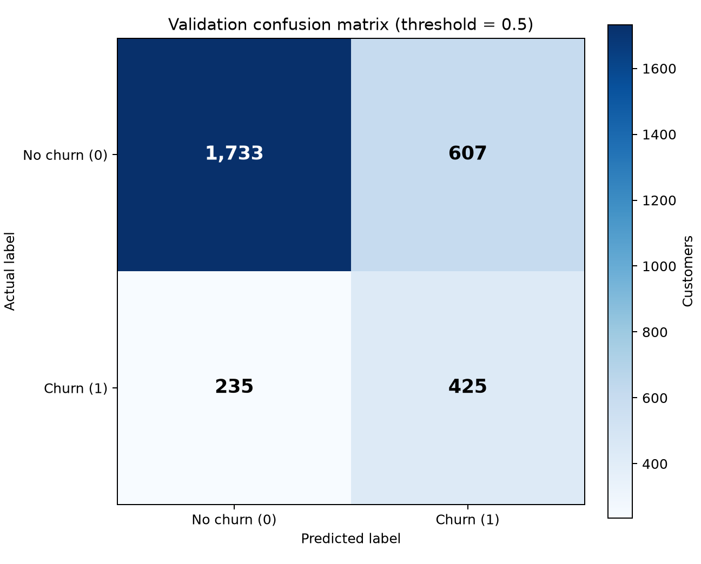
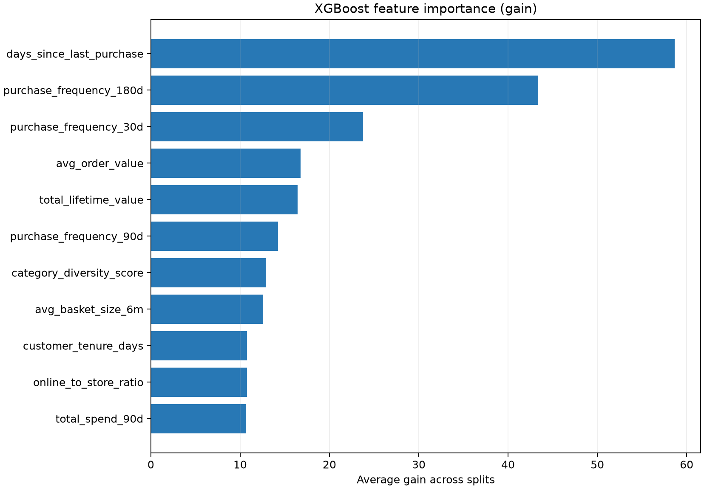

# Task 1 — Churn model evaluation

## Evaluation setup

The final run read the Lab 2 SageMaker Feature Store offline data through Athena (query ID `54001613-56bb-4785-aae6-b54fe445cd96`), then sorted and deduplicated customers in the training query. The dataset contained 9,999 customers. A stratified 70/30 split produced 6,999 training rows and 3,000 held-out validation rows (`random_state=42`). Missing feature values were filled with `-1`.

The final model was a local XGBoost 3.2.0 binary classifier using 11 features. Its configured hyperparameters were `max_depth=6`, `eta=0.1`, `num_round=200`, `min_child_weight=5`, `subsample=0.8`, `colsample_bytree=0.8`, and a training-split-derived `scale_pos_weight=3.5448`. The saved model reports best iteration 7.

## Held-out metrics

| Metric | Result | Interpretation |
|---|---:|---|
| AUC-ROC | 0.7819 | Reported; no absolute AUC gate |
| Recency-only baseline AUC | 0.7226 | Baseline trained on `days_since_last_purchase` alone |
| AUC lift over baseline | 0.0593 | Full-model AUC minus baseline AUC |
| Paired bootstrap 95% CI for lift | [0.0404, 0.0767] | Excludes zero; evidence the engineered model improves on recency |
| Precision in highest-scored 10% | 0.7167 | Passes the 0.50 minimum |
| Recall in highest-scored 10% | 0.3258 | Passes the 0.25 minimum |
| Validation customers | 3,000 | Held-out rows |

Precision and recall at the top 10% use a ranking cutoff over validation probabilities. The confusion matrix below uses a separate fixed classification threshold of 0.50.

The lift interval uses 2,000 paired bootstrap resamples of the same validation row indices for both models (seed 42); its endpoints are the 2.5th and 97.5th percentiles of the resampled AUC differences.

## Loyalty-tier slices

The table reports each tier's sample count alongside AUC and recall among customers selected by the same global top-10% score cutoff. A tier is marked too small when it has fewer than 20 positive or fewer than 20 negative validation examples.

| Tier | n | Positives | AUC | Recall@top10 | Too small |
|---|---:|---:|---:|---:|---|
| Silver | 1139 | 226 | 0.706 | 0.204 | No |
| Platinum | 307 | 21 | 0.879 | 0.095 | No |
| Bronze | 1071 | 361 | 0.760 | 0.443 | No |
| Gold | 483 | 52 | 0.752 | 0.135 | No |

Aggregate top-10% recall is 0.326. Tiers flagged as more than 10 percentage points below it are: **Silver (0.204; n=1139, positives=226); Platinum (0.095; n=307, positives=21); Gold (0.135; n=483, positives=52)**. The lowest recall is **Platinum**; its AUC is 0.879, showing why ranking quality and recall under a global contact budget tell different stories. Its positive count is just above the report's small-sample cutoff, so interpret that tier's recall cautiously. No tier meets the script's formal too-small rule.

Full slice results: [slice-evaluation.csv](lab3-evidence/slice-evaluation.csv).

## Feature importance

This plot uses XGBoost's average gain importance. It describes how the fitted model used features; it is not a causal explanation.

The highest-gain feature is **days_since_last_purchase**. Importance is conditional on this training sample and these model settings.

## Provenance and decision

The final run was logged in the `northstar-churn` MLflow experiment (run ID `3a142e64c8a14fa9a6e33095ce34adbe`) and registered as `arn:aws:sagemaker:us-east-1:722160254691:model-package/northstar-churn-models/4` with `PendingManualApproval`. The registered model is not approved for deployment. Evaluation gates passed: precision@top10 ≥ 0.50, recall@top10 ≥ 0.25, and the paired 95% confidence interval for AUC lift is above zero.
